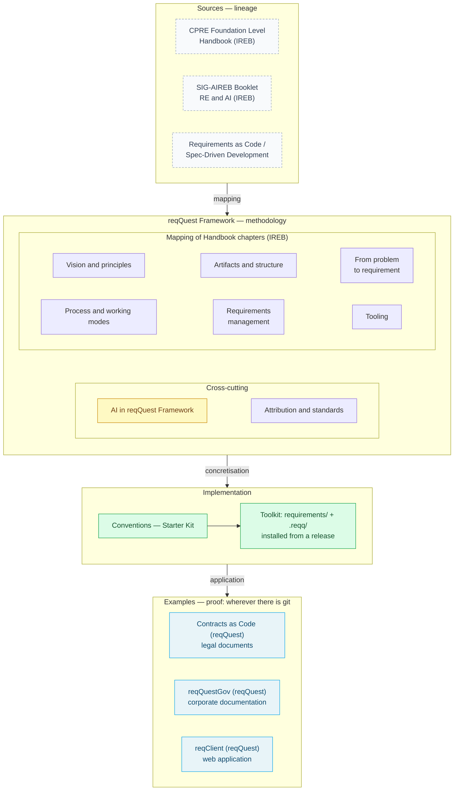

# reqQuest Framework

> **Level:** L0 — map of the methodology
> **Owner:** CTO

**reqQuest Framework** (Requirements-as-a-Code), as adapted by reqQuest, is a methodology for requirements engineering (RE) and for managing requirements as code. It builds on the **CPRE Foundation Level Handbook** (IREB e.V.) — a globally recognised, independent source of good practice in requirements engineering — and on the **Requirements as Code / Spec-Driven Development** lineage to which reqQuest Framework belongs (see [`vision-and-principles.md`](vision-and-principles.md), section "Lineage"). This is the foundation of value reqQuest brings: it lets the user (Product Owner, Business Analyst, Developer and others) answer the question *how to store and evolve requirements so that they can be traced, validated and maintained over time, and used to enrich the context of AI assistant models* — whatever those requirements describe.

**reqQuest Framework is domain-neutral.** IREB defines a "system" as anything stakeholders have requirements for — not only software. Today git stores much more than code. This methodology applies wherever decisions and requirements can be written down as versioned files. The most common use case is software development, but the methodology also works in other areas, e.g. drafting legal documents or maintaining a corporate documentation repository (see [`examples.md`](examples.md)).

This repository is at the same time the **documentation** of the methodology (this `docs/`) and the **source of the toolkit** — a working starter skeleton (`requirements/` + `.reqq/` in the root directory) that adopters install from the releases of the public repository (see [`../starter-kit.md`](../starter-kit.md)).

## Scope and roles

IREB defines a *system* broadly: anything stakeholders have requirements for — a product, a service, a component, a composition. reqQuest Framework takes this breadth literally: **the system boundary is the repository boundary** (or the boundary of a clearly separated module in a monorepo). Whatever lives in the repo — code, legal documents, corporate policies — is a "system" in the IREB sense, and its requirements are managed with the same mechanisms, whether the result is software, a contract or a documentation page.

The *Requirements Engineer* role in reqQuest Framework is not a separate job title — it is a function performed by everyone who elicits, documents, validates or manages requirements as part of their duties. reqQuest Framework defines a minimal role catalog explicitly and on its own — whether or not the project has additional domain-specific roles:

- **Human** — as the author/owner of an artifact (creates and changes requirements) and as the reviewer (approves the Pull Request; the final, irreplaceable gate of content quality — see [`vision-and-principles.md`](vision-and-principles.md), principle 6).
- **AI agent working under human supervision** — supports elicitation, documentation and validation, and never approves or merges a change on its own (expanded in [`ai-in-framework.md`](ai-in-framework.md)).

The project records domain-specific roles in the role catalog `roles.yaml` ([`conventions.md`](conventions.md#ownership-governance), section 7, "Ownership governance").

The validation scripts (front-matter schema, ID consistency — see `.reqq/` in this repo) are deliberately **not a third role**: they check only the quality of form (through a deterministic check, e.g. in CI, without judgement), never the quality of content — a distinction this methodology protects consistently (see [`artifacts-and-structure.md`](artifacts-and-structure.md), section "Quality Criteria for Work Products and Requirements"). The validator is a tool ([`tooling.md`](tooling.md)) that supports the RE process.

A fuller, domain-specific role catalog (e.g. Business Analyst, Architect) is an optional *extension* of this minimum, specific to a given deployment — not a dependency reqQuest Framework would have to wait for. For the role catalog of a specific project, see [`conventions.md`](conventions.md), section "Business case document".

**Proof of compliance:** the repository has an explicitly written system boundary (e.g. a "Scope" section in the introductory file) — not an implicit one, not "everyone knows what it covers".

## Context diagram

**Legend:** grey, dashed frame — an external source, never an executing node (we cite IREB materials by structure, not by content — [`attribution-and-standards.md`](attribution-and-standards.md)); no colour — methodology pages; yellow — AI, a layer that runs through the whole methodology; green — implementation: starter kit conventions and the toolkit installed from a release; blue — examples of application in reqQuest products, described in [`examples.md`](examples.md) (the products themselves are outside this repo).

## Organising principle of every page: triple mapping

The purpose of this documentation is to describe *how reqQuest Framework works* — it is not a translation of IREB material. Every content page keeps this format:

> **IREB requires X** (cited by Handbook chapter/section name, never by text) → **in reqQuest Framework the git-native mechanism Y implements it** (commit / tag / branch / PR / front-matter field / CI check) → **the proof of compliance is Z** (what an auditor actually checks) → **what omitting it risks**.

A page without the "proof of compliance" element is not finished — that column makes the methodology auditable and, eventually, certifiable.

## Structure of this area

| Section | Content |
|---|---|
| [`vision-and-principles.md`](vision-and-principles.md) | starting point — how reqQuest Framework implements the 9 IREB principles |
| [`artifacts-and-structure.md`](artifacts-and-structure.md) | What a requirement as a file looks like and how it is organised — artifact types, L0/L1 hierarchy, glossary, quality of form |
| [`from-problem-to-requirement.md`](from-problem-to-requirement.md) | From a source and a problem to a validated requirement — elicitation, conflicts, validation |
| [`process-and-working-modes.md`](process-and-working-modes.md) | Three facets of the process (time, goal, business context) → branch/PR/release strategy |
| [`requirements-management.md`](requirements-management.md) | Traceability, versioning, baseline, change, priority — **flagship page** |
| [`ai-in-framework.md`](ai-in-framework.md) | The role of AI agents in each principle, prompts as a versioned artifact |
| [`tooling.md`](tooling.md) | Tooling — the generic layer and reqQuest tools, how to choose and deploy them |
| [`conventions.md`](conventions.md) | Starter kit conventions: front matter, ID, lifecycle, traceability |
| [`examples.md`](examples.md) | Proof that it works beyond generic illustrations: reqQuestGov, Contracts as Code and reqClient (software-first) |
| [`attribution-and-standards.md`](attribution-and-standards.md) | IREB citation rules, legal status, the consolidated mapping table Handbook → reqQuest Framework |

**Glossary:** this documentation does not keep a separate glossary file of its own — it links directly to the base glossary in [`../../requirements/00-context/glossary.md`](../../requirements/00-context/glossary.md) (starter kit), to avoid two parallel, diverging copies of the terminology. Project terms go next to it, into `glossary.project.md` (see [`artifacts-and-structure.md`](artifacts-and-structure.md), section "Glossaries").

## Entry points

- New to the reqQuest Framework methodology? → start with [`vision-and-principles.md`](vision-and-principles.md)
- Want to see the mapping IREB → git mechanisms? → [`requirements-management.md`](requirements-management.md)
- Interested in the role of AI in the reqQuest Framework process? → [`ai-in-framework.md`](ai-in-framework.md)
- Deploying reqQuest Framework in your repository → [`../starter-kit.md`](../starter-kit.md) (toolkit installation) + [`conventions.md`](conventions.md)
- Looking for proof that it works beyond software development → [`examples.md`](examples.md)

## Related documents

- [`attribution-and-standards.md`](attribution-and-standards.md) — legal status of IREB materials, citation convention
- [`../../requirements/README.md`](../../requirements/README.md) — the starter skeleton of `requirements/`
- [`../../.reqq/README.md`](../../.reqq/README.md) — the validator and starter schemas of `.reqq/`
