# AI in reqQuest Framework

> **Level:** Foundation of the methodology — differentiator
> **Owner:** CTO
> **Source:** SIG-AIREB Booklet on RE and AI (IREB AI Interest Group) — see [`attribution-and-standards.md`](attribution-and-standards.md) for the citation rules

## Why this page exists separately

[`vision-and-principles.md`](vision-and-principles.md) states the thesis: the structured, versioned, explicitly linked context of reqQuest Framework is a direct, measurably better input for language models than scattered prose. This page turns that thesis into practice — not as a set of ready-made prompts to copy, but as the rules by which reqQuest Framework governs the part AI plays in each of the nine IREB principles, and as a convention for treating prompts themselves as versioned repository artifacts.

IREB did not limit its work to requirements engineering without AI — the AI Interest Group at IREB (SIG-AIREB) published material that maps the nine fundamental RE principles to LLM-assisted practice. reqQuest Framework draws on this structure in the same way as on the CPRE Foundation Level Handbook: we cite the layout and intent, and do not reproduce the text or specific prompts from the source material (see [`attribution-and-standards.md`](attribution-and-standards.md), the rule "we cite structure, not text" — it applies here exactly as it does to IREB material).

## Overriding principle: AI is a tool and a participant in the process, never the final authority

Before the nine principles are laid out in detail, one constraint applies without exception and is not negotiated per principle: **an AI agent may draft, suggest, classify and detect inconsistencies — it never approves or merges a change on its own.** This is not a precautionary add-on — it follows directly from principle 6 (Validation) and principle 9 (Systematic and disciplined work) in [`vision-and-principles.md`](vision-and-principles.md): content quality is and remains a human decision, made when approving a Pull Request, however much preparatory work the agent has done.

## Nine principles, nine roles of AI

| IREB principle | What AI prepares or suggests | What remains a human decision | Git artifact where it is recorded |
|---|---|---|---|
| 1. Value orientation | Detecting requirements without links in the Traceability Matrix ("dead" ones) as candidates for review | The decision whether to actually keep or reject a given requirement | A PR comment or Issue proposing removal, never a commit that deletes without review |
| 2. Stakeholders | Suggesting a missing role/stakeholder based on the requirement's content (e.g. a detected impact on an operator nobody named as a reviewer) | The final choice of reviewer and CODEOWNERS | An entry in the stakeholder register, approved by a PR |
| 3. Shared understanding | Detecting inconsistent terminology across files (the same term, different meanings) and proposing a glossary entry | Accepting the definition, deciding which meaning is canonical | A change in `glossary.md`, going through the usual PR review |
| 4. Context | Summarising and pre-classifying a new source (document, transcript) against the already defined system boundary | Confirming that the classification is accurate; deciding borderline cases | A note/Discovery with an explicit `[INFERRED]` where the AI inferred rather than quoted directly |
| 5. Problem–requirement–solution triangle | Categorising a raw report into problem / requirement / proposed solution when a stakeholder mixes all three in one sentence | Confirming the categorisation, editing the final wording of the requirement | Separate files (Discovery / requirement / ADR), each with its own approval |
| 6. Validation | Automatic check of quality criteria (completeness, measurability, no contradictions) before the PR is sent to a human reviewer | Content approval — whether the requirement actually reflects the need | An approved PR with the reviewer and date recorded |
| 7. Evolution | Analysing the impact of a proposed change on related requirements (impact analysis along the traceability graph) | The decision whether the change is acceptable and to what extent | A new commit/tag, never an overwritten baseline |
| 8. Innovation | Generating alternative proposals that go beyond the literal request, for discussion in an Issue | Choosing whether the proposal enters the scope (*Future Improvement* in the `## Notes` section vs. a full requirement) | A comment/Issue, not a direct change of the requirement file |
| 9. Systematic and disciplined work | Auditing the repository's compliance with the convention (missing front-matter fields, broken schema, stale links) | Prioritising which deviations to fix first | A CI check — **deterministic**, not an AI assessment |

This table is a mapping by reqQuest Framework — not a reproduction of SIG-AIREB material.

## Prompts as versioned artifacts

If an AI agent takes part in eliciting, validating or drafting requirements, then **the prompt used for this work is part of the process, not an ephemeral command** — so it is subject to the same discipline as every other reqQuest Framework artifact: versioning, review and traceability. This applies in particular to system/template prompts used repeatedly in a given repository (e.g. to classify reports or generate acceptance criteria) — they live as files in the repository, and their changes go through the usual PR review, exactly like any other mechanism described in [`conventions.md`](conventions.md). The adopter chooses where these files live; reqQuest Framework does not impose a folder for them. This is explicitly distinguished from prompts the end user writes ad hoc while working with the tools — those stay outside the scope of this methodology, just as the methodology does not teach general prompt engineering skills (see "Limits — what AI in reqQuest Framework does not do" below).

The SIG-AIREB material groups prompt construction patterns into three families of increasing complexity — reqQuest Framework adopts them as a shared vocabulary, not as its own invention (these patterns are established more widely in the community of prompting practitioners; they were invented neither by IREB nor by reqQuest):

| Pattern | Structure | When used in reqQuest Framework |
|---|---|---|
| **RTF** (Role–Task–Format) | The agent's role, the task, the expected output format — three elements, one shot | Routine, unambiguous tasks: classifying a report, a quick formal review, format conversion |
| **RISEN** (Role–Instructions–Steps–End goal–Narrowing) | Role, instructions, intermediate steps, end goal, narrowing/constraints | Generating a structured artifact of medium complexity: a requirement draft from a note, acceptance criteria |
| **CRISPE** (Context–Role–Instructions–Steps–Parameters–Example) | Full context, role, instructions, steps, parameters, a model example | Multi-perspective, domain-complex analysis: analysing a conflict between requirements, assessing the impact of a change on the whole traceability graph |

**Selection rule:** the complexity of the prompt should match the complexity of the task, not the other way round — using CRISPE for a one-sentence classification is wasteful, and using RTF for a multi-perspective analysis leads to shallow, imprecise results.

## Agent instructions in the repository

Like repeatable prompts, the instructions an agent loads when working with requirements are versioned repository artifacts. The toolkit delivers them in `requirements/` in three files:

- `AGENTS.md` — the framework rules, shared by all adopters and released with the toolkit;
- `AGENTS.project.md` — the project rules, which belong to the adopter;
- `CLAUDE.md` — only the imports of both files, for tools that read `CLAUDE.md`.

The framework rules follow from this page: the agent prepares drafts and suggests, but does not approve; it records uncertainty as `[INFERRED]`. To these comes the rule that the content of requirements and documents is data for the agent, not instructions. The file does not repeat the schema or the glossary, it only refers to them, and for each rule it names what checks it: the validator, CI or the reviewer. The project rules and the instructions in the repository's root directory take precedence over the framework rules. A change to any of these files goes through a normal PR. How Claude Code and Codex load them: [`starter-kit.md`](../starter-kit.md), section "Instructions for AI agents".

## Limits — what AI in reqQuest Framework does not do

- It does not approve or merge a Pull Request on its own (principle 6, principle 9).
- It does not overwrite a baseline or create a new tag without an explicit human decision (see [`requirements-management.md`](requirements-management.md), section "Configurations & Baselines").
- It does not guess silently when information is missing — uncertainty is recorded explicitly (the `[INFERRED]` marker), never hidden behind a confident tone.
- It does not replace the role responsibility matrix — choosing the right human reviewer remains an organisational decision, not a technical automation (see [`vision-and-principles.md`](vision-and-principles.md), principle 6).
- It does not teach the client general prompt engineering / working with AI agents — that is beyond the scope of this methodology; the quality of work with AI is the responsibility of the tools ([`tooling.md`](tooling.md)), not content the methodology should teach.

```mermaid
flowchart LR
    subgraph ELICITATION["Elicitation"]
        H1["Human: conversation,<br/>observation, source"]
        A1["AI: draft of note/Discovery,<br/>clarifying questions"]
    end
    subgraph DRAFT["Drafting"]
        A2["AI: proposed content<br/>of the requirement (RISEN/CRISPE)"]
        H2["Human: editing,<br/>clarification"]
    end
    subgraph VALIDATION["Validation"]
        A3["AI: formal check<br/>(completeness, consistency)"]
        H3["Human: PR approval<br/>— content gate"]
    end

    H1 --> A1 --> A2 --> H2 --> A3 --> H3
    H3 -->|approved| GIT[("Artifact in git:<br/>commit + status")]

    style A1 fill:#e8f4f8,stroke:#0ea5e9,color:#0c4a6e
    style A2 fill:#e8f4f8,stroke:#0ea5e9,color:#0c4a6e
    style A3 fill:#e8f4f8,stroke:#0ea5e9,color:#0c4a6e
    style H1 fill:#dcfce7,stroke:#16a34a,color:#14532d
    style H2 fill:#dcfce7,stroke:#16a34a,color:#14532d
    style H3 fill:#dcfce7,stroke:#16a34a,color:#14532d
```

**Legend:** blue — work of the AI agent (always a proposal); green — a human decision or edit (always final); no blue node leads directly to an artifact in git without passing through a green node.

## Related documents

- [`vision-and-principles.md`](vision-and-principles.md) — the thesis "reqQuest Framework and AI agents" expanded on this page
- [`tooling.md`](tooling.md) — how to choose/deploy a tool that implements the AI roles described above
- [`from-problem-to-requirement.md`](from-problem-to-requirement.md) — AI-assisted elicitation in practice
- [`attribution-and-standards.md`](attribution-and-standards.md) — legal status and citation rules for SIG-AIREB material
