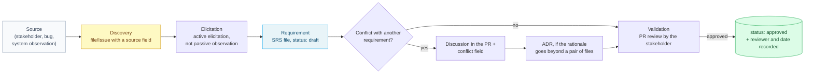

# From Problem to Requirement

> **Level:** Foundation of the methodology
> **Owner:** reqQuest
> **Implements:** CPRE Foundation Level Handbook, chapter Practices for Requirements Elaboration (see [`attribution-and-standards.md`](attribution-and-standards.md#handbook-mapping-table))

IREB divides requirements elaboration into four practices: finding the right sources, actively eliciting from them, resolving conflicts between contradictory needs and validating the result. reqQuest Framework implements all four as repository artifacts, so that they follow versioning and management rules analogous to those applied to code.

## Mapping table

| IREB practice | reqQuest Framework mechanism | Evidence of compliance | What breaks without it |
|---|---|---|---|
| **Sources for Requirements** — stakeholders, documents, existing systems, bug reports, feedback | An Issue as the entry point for every source (a request from a stakeholder, a bug, a finding from analysing existing code); an interview note as a file with a date and participants | Every requirement links to the Issue or note it comes from — the source is one click away from the requirement, not in the memory of the person who collected it | The requirement "just is" in the document, with no way to verify whether it really comes from a real need or from the author's assumption |
| **Elicitation of Requirements** — active elicitation, not passive observation | A structured Issue template (questions that force specifics) instead of free text; interviews and workshops documented as Discovery **right after the meeting**, as input to elicitation — **the product/artifact of this step is the requirement** (an SRS file), not the note itself. Discovery is a source (see above), the requirement is the result of active elicitation based on it | Every requirement links back to the Discovery/Issue it came from, and its creation date is close to the meeting date (git commit timestamp) — evidence that elicitation was documented as it happened, not reconstructed later | Notes written "from memory" a week later lose precision, and gaps get filled with assumptions instead of facts; if Discovery is confused with the product of elicitation, the distinction between raw input and a validated requirement is lost |
| **Resolving Conflicts regarding Requirements** — identifying, analysing, resolving and documenting a conflict | A discussion thread in a Pull Request as the place where the conflict is identified; the `conflict` field in the front matter (see the section below) documenting the tension with another requirement and the resolution adopted; an ADR as a permanent record of the broader rationale when the conflict goes beyond one pair of artifacts | The PR comment history is an undeletable record of how the decision was reached — not only the result, but also the rejected alternatives. This pattern has a live, fully traced production example: [`examples.md`](examples.md#case-study-contracts-as-code-as-reqquest-framework) | The conflict is "resolved" orally at a meeting, and half a year later someone replays the same discussion from scratch, because nobody wrote down why option A was chosen and not B |
| **Validation of Requirements** — do the requirements reflect real needs, are they consistent | A required review (Pull Request approval) by a role representing the stakeholder before the change reaches the main branch; a CI check as validation of formal consistency | A merged PR has the approver and the date recorded — permanent evidence that validation took place, not just a declaration | The requirement goes into implementation without confirmation that the stakeholder actually agrees with it — the discrepancy is found only at acceptance |

## Flow: from problem to approved requirement



**A terminological distinction, used consistently throughout the documentation:** *Discovery* is the name of an L0 artifact type (see [`artifacts-and-structure.md`](artifacts-and-structure.md)); *note* is the informal name of its form when it takes shape as a Markdown file; *Issue* is its form as an object of a git hosting platform (a GitHub Issue or equivalent). All three words refer to the same artifact in different contexts — not to three different things.

## Where sources come from — the Kano model as a priority filter

Not every source deserves the same attention. CPRE Foundation Level introduces the **Kano model** as a way to classify stakeholder expectations by how meeting them (or not) affects satisfaction — reqQuest Framework adopts this classification as a filter during elicitation, not as a separate artifact:

- **Basic (must-be)** — their absence causes dissatisfaction, their presence is neutral (expected, unnoticed when they work).
- **Performance** — satisfaction grows in proportion to the degree of fulfilment — the more, the better, plainly.
- **Attractive (delighters)** — their absence is neutral, but their presence increases satisfaction disproportionately — the source of principle 8 (Innovation, see [`vision-and-principles.md`](vision-and-principles.md#8-innovation)).

**In reqQuest Framework:** the Kano classification is not a separate front-matter field — it is a heuristic used in prioritisation (the `priority` field, see [`requirements-management.md`](requirements-management.md)) and in deciding whether an idea goes into a formal requirement or into the `## Notes` section as a *Future Improvement* (see [`vision-and-principles.md`](vision-and-principles.md#8-innovation)). A basic requirement missed in prioritisation is a much more costly mistake than a missed attractive requirement — the Kano model gives a vocabulary for this conversation.

## Types of conflict, before moving on to resolving them

Before a thread in the PR (see the table above) even opens, it is worth recognising what kind of conflict you are dealing with — the Handbook distinguishes them by the source of the tension, not only by the symptom:

| Conflict type | Source of tension | Typical signal in the repository |
|---|---|---|
| **Between stakeholders** | Two roles want contradictory things from the same system | Two Issues/Discovery entries pointing to the same area with opposite demands |
| **Within one requirement** | The requirement itself contains contradictory acceptance criteria | Detectable in formal validation (CI check) or review — the criteria exclude each other |
| **Between requirements** | Two separate requirements, each correct on its own, cannot be met at the same time | The `conflict` field (see below) linking two IDs |
| **Technical/resource** | The requirement is correct and consistent with the others, but not feasible within the available budget/time/technology | A PR comment pointing to an ADR on constraints, not to another requirement |

The distinction matters in practice: a conflict between stakeholders needs a business decision (who takes precedence), a conflict within a requirement needs only editing, and a resource conflict is not a conflict of *requirements* at all — confusing these three cases leads to looking for a solution of the wrong kind.

## The `conflict` field

reqQuest Framework adopts `conflict` as a front-matter field symmetrical to `traces_to` (see [`conventions.md`](conventions.md), section 4), not as a separate file type — a conflict is a relation between two existing requirements, not a new artifact. The shape of the field is confirmed:

```yaml
conflict:
  - with: <ID of the conflicting requirement>
    resolution: <accepted | rejected | superseded>
    rationale: <ID of the PR or ADR where the rationale is recorded>
```

`with` is always required; `resolution` is added once the conflict is resolved. Put a value that contains `#` (e.g. `"PR #14"`) in quotes — without them YAML treats the rest of the line as a comment.

Choosing a field instead of a separate file type is consistent with how reqQuest Framework treats `traces_to` — the relation is cheap to write and greppable, without the overhead of creating and maintaining an extra artifact for every pair of conflicting requirements.

### Lifecycle of the `conflict` field

- **Gate before implementation:** a requirement with at least one entry in `conflict[]` without `resolution` set cannot reach the status `approved` (see [`requirements-management.md`](requirements-management.md), section "Artifact lifecycle").
- **Permission to change `resolution`:** only the reviewer(s) from CODEOWNERS responsible for the area of *both* conflicting requirements (see [`conventions.md`](conventions.md#ownership-governance), section 7, "Ownership governance") — the change always goes through a Pull Request, never a direct commit.
- **After the conflict is resolved:** the entry **is not removed** — it stays in `conflict[]` with `resolution` set as a permanent, machine-readable trace of the decision, and the description of the resolution goes into the `## Notes` section in the body of the requirement. The full history is recorded in git anyway, but the entry and the note leave a readable trace in the file itself, without having to search the commit history.
- **Semantics of `rejected`:** it means that **this** requirement (the file carrying the `conflict` field) was rejected in favour of the requirement named in `with` — not that the conflict itself was judged irrelevant.

The reference validator (`.reqq/validator/reqq_validate.py`) enforces the gate and the shape of the entries: an entry without `with`, a `resolution` outside the list of values and an entry without `resolution` under the status `approved` are errors — exit code `2`. The permission to change `resolution` remains a rule of the Pull Request process, not of the validator.

## Elicitation techniques — gathering and design

The methodology distinguishes elicitation techniques by whether they *gather* existing knowledge (interview, workshop, code analysis, document analysis, observation) or *create* new knowledge together with the stakeholder (prototyping, brainstorming, joint design). reqQuest Framework does not impose a specific technique — both families end with the same artifact (Discovery → requirement); they differ only in what happens before the Discovery is created. A design technique (e.g. a prototyping workshop) usually produces more than one Discovery per session — reqQuest Framework treats this as a normal case, not an exception that needs a separate convention.

## Elicitation and AI

When elicitation is run or supported by an AI agent working under human supervision (see [`_index.md`](_index.md#scope-and-roles)), the principle "active elicitation, not passive observation" does not go away — the agent shall ask clarifying questions and record uncertainty explicitly (e.g. with the `[INFERRED]` marker) instead of filling gaps with a silent assumption. For the full account of the role of AI in each of the nine principles, elicitation included, see [`ai-in-framework.md`](ai-in-framework.md). For tools that support AI-assisted elicitation, see [`tooling.md`](tooling.md).

## Related documents

- [`_index.md`](_index.md) — map of the whole methodology
- [`artifacts-and-structure.md`](artifacts-and-structure.md) — the form in which the result of elaboration is recorded, the L0/L1 hierarchy
- [`requirements-management.md`](requirements-management.md) — how a requirement change ties in with conflict resolution
- [`ai-in-framework.md`](ai-in-framework.md) — the role of AI in elicitation and conflict classification
- [`examples.md`](examples.md#case-study-contracts-as-code-as-reqquest-framework) — a conflict between requirements as a live example
