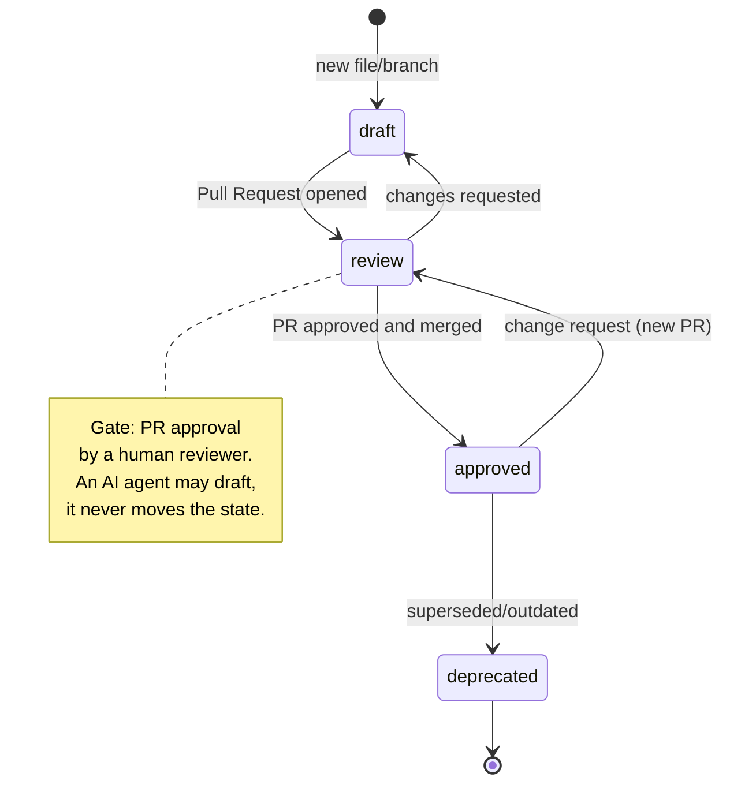
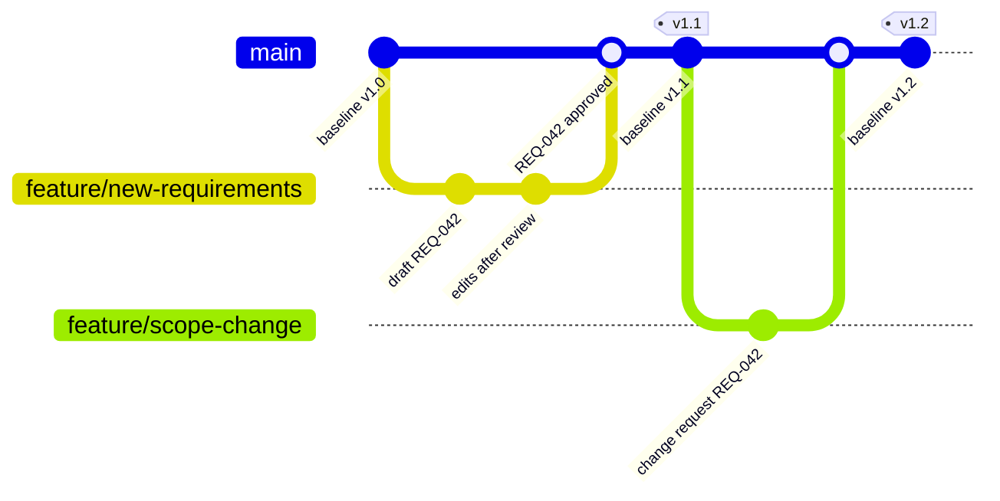
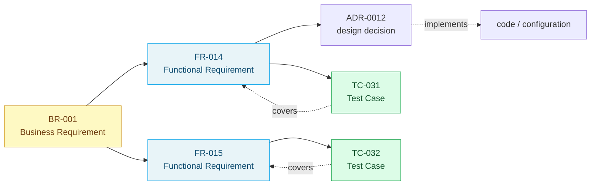

# Requirements Management

> **Level:** Foundation of the methodology — flagship page
> **Owner:** reqQuest
> **Implements:** CPRE Foundation Level Handbook, chapter Management Practices for Requirements (see [`attribution-and-standards.md`](attribution-and-standards.md#handbook-mapping-table)). This chapter opens with an introduction that defines the concept of requirements management itself, without a separate practice to map to its own table row — its content is already covered by the paragraph "Why this page is the flagship" below.

## Why this page is the flagship

Of all CPRE Foundation Level practices, requirements management maps most strongly, almost 1:1, to the mechanisms that git provides *by default*. This is no accident — requirements management (storing, versioning, tracking changes, controlling state) and source code management solve exactly the same problem: how to keep a set of related artifacts that change over time in a consistent, verifiable state. Git solved this problem for code decades ago. reqQuest Framework applies the same solution to requirements.

## Mapping table

| IREB practice | reqQuest Framework mechanism | Evidence of compliance | What breaks without it |
|---|---|---|---|
| **Life Cycle Management** | The `status` field in the front matter of every artifact (`draft` / `review` / `approved` / `deprecated`), changed by a commit | `git log --follow -- <file>` shows the full history of state transitions | Nobody knows whether a given document is in force, historical, or abandoned halfway through writing |
| **Version Control** | The commit history of the requirement file — every change is a new version with an author, a timestamp and a message | `git log -p -- <file>` reconstructs any earlier version and the reason for the change | The requirement is silently overwritten; there is no way to reconstruct what was in force when a design decision was made |
| **Configurations & Baselines** | Configuration = branch (a consistent set of files in progress, changeable). Baseline = **git tag** (a lightweight, informational marker pinned to a specific commit — there may be many of them between releases; tags are used e.g. by CI/CD pipelines to number builds) **or git release** (an independent object that references a tag/commit and produces packaged artifacts and release notes) — these are two different mechanisms, not synonyms (see the section "Configurations and baseline" below for the full distinction). **A baseline is never edited retroactively** — every change of agreements after it is established creates a new tag/release, never overwrites the old one (the "Unchangeability" property of a configuration) | `git tag` + `git show <tag>:<file>` reconstructs the exact, indisputable state of the requirements used for a specific decision (e.g. an estimate, a release) | There is no reference point to compare "what we agreed" with "what is there today" — every conversation about a discrepancy becomes a reconstruction from memory; an editable baseline stops being a reliable reference point for business decisions |
| **Attributes & Views** | Front-matter fields (`owner`, `status`, `tags`, `priority`, `id`) as attributes; filtering/grouping by these fields (e.g. in a script or a tool) as views | A query on the front matter (grep/script) returns exactly the requirements that meet the criterion — without manual browsing | Every question like "which requirements are critical and not yet reviewed" needs a manual search of the whole set |
| **Traceability** | An identifier + link in the front matter (e.g. `traces_to: [<ID>, ...]`) and/or inline in the body — see [`conventions.md`](conventions.md) for both variants and the criterion for choosing between them | A grep for the ID returns every file that refers to it — in both directions. A full, end-to-end traced example: [`examples.md`](examples.md#case-study-contracts-as-code-as-reqquest-framework) | The requirement exists in a vacuum: nobody knows where it comes from or what implements it — a compliance audit turns into archaeology |
| **Handling Change** | Change request = an Issue or a branch; the acceptance decision = a merged Pull Request with its review history; `CODEOWNERS` from the role catalog assigns the area reviewers, and the `enforce` level requires their approval ([`conventions.md`](conventions.md#ownership-governance)) | A merged PR is a permanent, signed (author + reviewer) record of the change decision | The requirement change happens outside the system (a conversation, an e-mail) and never makes it back to the source of truth |
| **Prioritization** | Prioritisation of **requirements** (not tasks/issues — managing a task backlog is outside the scope of this methodology, see [`vision-and-principles.md`](vision-and-principles.md), principle 4) through the `priority` field in the front matter of the requirement file, informed by the Kano classification (see [`from-problem-to-requirement.md`](from-problem-to-requirement.md)) | A query on the `priority` field (grep/script) returns a sorted, auditable list of requirements by priority | Priorities live in one person's head and change without a trace when that person is unavailable |

## Source of truth and views

In a repository that adopts the methodology, `requirements/` is the **single source of truth** about what the system is to do and why: BR, FR, NFR, ADR, TC, POL and `00-context/`. All other documentation (`docs/`, README, HLD and LLD designs, diagrams, API descriptions) is a **view** of the requirements. A view may summarise, explain, draw and derive from the requirements, but it never defines or changes a requirement.

Requirements with the status `approved` are authoritative. `draft` and `review` are proposals, and `deprecated` is a historical record: none of them forces a change to views or code until it goes through `review` to `approved`.

Truth is aligned in one direction: requirements → views.

- A view contradicts an `approved` requirement: the requirement wins, we fix the view.
- A requirement is wrong or outdated: we change it first in `requirements/` (`version` and `status` according to the lifecycle below), then align the views.
- A fact appears only in a view: it is a gap in the requirements. We add it to the requirements or remove it from the view; the view does not become authoritative because of it.
- Code and tests implement and verify requirements. A discrepancy is reported, not resolved silently by fitting the requirement to the code.

Without this principle a reader, human or AI agent, does not know which of two diverging documents to fix, and sometimes fixes the source to match the view.

The same direction applies inside the source of truth. The business case document ([`conventions.md`](conventions.md), section 7) takes precedence over requirements and ADRs: references lead to it, and changes flow down from it.

1. A new high-level thread, e.g. from a discussion of the Product Owner, a business analyst or other stakeholders, goes first into the business case document. A human approves the change to it in a PR, and it binds from the merge.
2. Then we carry its effects into the more detailed documents: ADR, NFR and FR. Each of them goes through its own lifecycle and binds only as `approved`.

## Artifact lifecycle — draft/approved, not SPIKE



**Reading the diagram:** the only transition that gives the status `approved` the force of a requirements source goes through the `review` node — there is no shortcut from `draft` straight to `approved`. This is exactly where reqQuest Framework rejects the idea of a separate "prototype"/"SPIKE" state (see [`artifacts-and-structure.md`](artifacts-and-structure.md)): experimenting happens in `draft`, on a branch, without creating a third, parallel status.

## Configurations and baseline — how a branch differs from a tag and a tag from a release



**Reading the diagram:** `v1.1` stays available under its tag forever — `git show v1.1:requirements/REQ-042.md` returns exactly that version, no matter how many later baselines are created. A branch (`feature/...`) is a place for work in progress — changeable, temporary, deletable after the merge. The same principle applies whether the repository holds code, legal documents or corporate documentation.

**A tag and a release are not synonyms.** A tag is a short piece of information pinned to a specific commit — there may be many of them between consecutive releases, and they are used e.g. by CI/CD pipelines to number builds. A release is an independent object that refers to a specific tag/commit and comes with the creation of artifacts (packaged files, a repository snapshot) and release notes (release description). reqQuest Framework **deliberately does not decide** how the client versions or releases its own application or repository — that is up to the client's development team. The methodology concerns only the requirements baseline: when freezing a set of requirements, the recommended mechanism is a **release** (because it comes with packaged artifacts and a description), not a tag alone. A requirements baseline is not the same as a reqQuest Framework toolkit release (`toolkit-vX.Y.Z`) — the toolkit versions the framework's tools (schema, validator, templates), not the client's requirements.

## Traceability as the centre of gravity

Traceability deserves special emphasis: it is the practice around which reqQuest builds its competitive advantage. IREB distinguishes *implicit* traceability (through the structure and standardisation of documents) and *explicit* traceability (through explicit identifiers and relations). reqQuest Framework chooses **explicit** as the default mode — not because implicit is bad, but because only explicit traceability can be checked by a machine in CI, and so scales beyond what one person can keep in memory.



The pattern that implements it is simple: an identifier + a link in both directions, enforced by a naming convention and checkable with git alone — without any dedicated RE tool (see [`conventions.md`](conventions.md)). Evidence that it works in practice, not only in theory: [`examples.md`](examples.md#case-study-contracts-as-code-as-reqquest-framework) — a requirement links a legal document in both directions, with a source annotation right in the template, traced end to end.

## Coverage — a proposed definition

*(Recommendation for approval.)* "Coverage" without a defined denominator is a meaningless number — reqQuest Framework proposes to define it as:

> **Coverage** = the ratio of requirements that have at least one `covered_by` link to a specified type of deciding artifact (code, test, document, process) to all requirements in a given scope (repository, module, release).

The key design decision: **the denominator shall be declared explicitly** (e.g. "coverage by tests" and "coverage by implemented ADRs" are two different numbers, not one) — mixing them gives a deceptively precise, in reality uninterpretable indicator. The field proposed for the front matter:

```yaml
covered_by:
  - type: test | code | document | process
    ref: <ID or path of the deciding artifact>
```

This definition is deliberately domain-neutral: "test coverage" for a software requirement and "contract clause coverage" for a legal requirement (see [`examples.md`](examples.md#case-study-contracts-as-code-as-reqquest-framework)) are the same mechanism with a different `type`.

**Where to compute and store coverage/traceability — a tooling decision, not a methodological one.** reqQuest Framework defines *what* coverage is (an explicit denominator, `covered_by` as a relation) and *where* the source truth comes from (front-matter fields, grep for the ID) — it does not impose *where* the computed result is stored. Traceability/coverage as an **on-demand function of the tooling** (see [`tooling.md`](tooling.md)), reading the source of truth from the requirement files, scales better than traceability/coverage as a **committed, jointly edited result file** — a file that aggregates metrics, touched with almost every change to requirement content, produces a significant share of merge conflicts proportional to the frequency of changes. reqQuest Framework recommends the first approach as the default; the second remains acceptable for very small repositories where the frequency of changes is low.

## Related documents

- [`_index.md`](_index.md) — map of the whole methodology
- [`conventions.md`](conventions.md) — a ready ID and front-matter schema that implements this table in practice
- [`examples.md`](examples.md#case-study-contracts-as-code-as-reqquest-framework) — traceability in a live example
- [`process-and-working-modes.md`](process-and-working-modes.md) — process facets that determine how intensively to apply the practices above
- [`ai-in-framework.md`](ai-in-framework.md) — the role of AI in change impact analysis over the traceability graph
